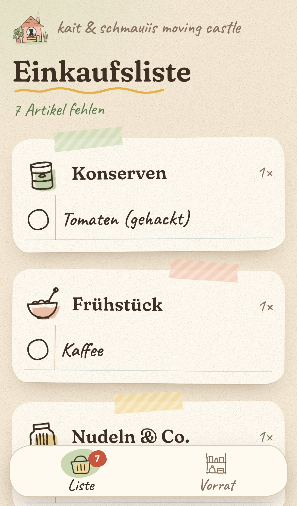

# 🏰 kait & schmauiis moving castle

Kleine Web-App für zu Hause: **Vorrat** (was wir immer dahaben wollen) und **Einkaufsliste** (was gerade fehlt).
Läuft auf einem Raspberry Pi oder Mini-PC im Heimnetz und wird per NFC-Sticker geöffnet.

| Adresse | Ansicht |
|---|---|
| `http://haushalt.fritz.box:8080/#/liste` | Einkaufsliste: nur, was fehlt. Antippen = gekauft |
| `http://haushalt.fritz.box:8080/#/vorrat` | Vorrat: alle Artikel. Antippen = fehlt |



## Schnellstart

```bash
mkdir -p data
docker compose up -d --build
```

Danach erreichbar unter `http://<server>:8080`.

## Anleitungen

- [docs/ONLINE.md](docs/ONLINE.md): **Online-Server** (z. B. Hetzner) mit HTTPS und Haushalts-Passwort – App funktioniert überall, auch im Supermarkt
- [docs/INSTALLATION.md](docs/INSTALLATION.md): Alternative zu Hause (Raspberry Pi): Docker installieren, starten, feste IP in der FritzBox, Updates, Backup
- [docs/NFC.md](docs/NFC.md): NFC-Sticker mit „NFC Tools“ beschreiben, App-Icon auf dem Home-Bildschirm
- [docs/ANPASSEN.md](docs/ANPASSEN.md): Design ändern, neue Felder, Kategorien und Bereiche ergänzen

## Technik in Kürze

- **Server:** Node.js ohne Zusatzpakete und mit eingebautem SQLite (`node:sqlite`). Die Daten liegen in `data/haushalt.db`.
- **Frontend:** HTML, CSS und JavaScript (ES-Module), ohne Build-Schritt. Die Design-Variablen stehen in `public/css/tokens.css`. Das Thema heißt „Küchen-Skizzenbuch“, die Schriften sind Fraunces, Nunito und Caveat (lokal eingebunden, OFL-Lizenz).
- **Sync:** Alle Geräte fragen alle 4 Sekunden und beim Zurückkehren in die App nach Änderungen. Hat sich nichts geändert, antwortet der Server nur mit „304“.
- **Sicherheit:** Online mit HTTPS (Caddy) und gemeinsamem Passwort (`HAUSHALT_PASSWORT`, Sitzungs-Cookie, Bremse gegen Durchprobieren). Ohne Passwort ist die Anmeldung aus – dann nur im Heimnetz ohne Portfreigabe nutzen. Eingaben werden auf dem Server geprüft, Ausgaben werden immer als Text eingefügt, dazu kommt eine strenge Content-Security-Policy.

## Ordnerstruktur

```
server/                 Backend
  server.js             Start, /api/state, Sicherheits-Header
  config.js             Port, Datenordner, Passwort usw.
  auth.js               Anmeldung mit Haushalts-Passwort
  backup.js             Sicherung der Datenbank (npm run backup)
  migrations.js         Datenbank-Schema (neue Spalten/Tabellen hier anhängen)
  resource.js           Generische REST-API aus einer Felddefinition
  validate.js           Eingabeprüfung je Feldtyp
  modules/              Ein Modul je Bereich (categories, items, …)
startdaten.json         Startbefüllung beim allerersten Start
public/                 Frontend
  index.html
  css/tokens.css        ← Farben, Schrift, Abstände, Rundungen
  css/fonts.css         Schriften (lokal in public/fonts/)
  css/layout.css        Handy/Tablet/PC-Layout und Breakpoints
  css/components.css    Karten, Chips, Buttons, Haftnotiz
  css/decor.css         Deko: Papier, Aquarell, Washi-Tape (optional)
  img/                  Illustrationen und Texturen (SVG)
  js/config.js          Abfrage-Intervall, Startseite, PC-Nebeneinander
  js/store.js           Daten und Aktionen
  js/views/             Eine Datei pro Ansicht (liste.js, vorrat.js)
test/api.test.js        API-Tests (npm test)
scripts/                Server-Einrichtung, Screenshots, App-Icons
docker-compose.yml      Betrieb zu Hause (ohne Passwort)
docker-compose.online.yml + Caddyfile   Betrieb online mit HTTPS
```

## REST-API

| Methode | Pfad | Zweck |
|---|---|---|
| GET | `/api/state` | alles auf einmal (Kategorien und Artikel), mit ETag |
| GET | `/api/items` | Artikel; Filter z. B. `?missing=true`, `?categoryId=3` |
| GET | `/api/items/:id` | ein Artikel |
| POST | `/api/items` | `{ "categoryId": 1, "name": "Mais", "quantity": 2, "unit": "Dosen", "note": "…" }` |
| PATCH | `/api/items/:id` | z. B. `{ "missing": true }` |
| DELETE | `/api/items/:id` | löscht den Artikel und gibt ihn zurück (für „Rückgängig“) |
| *gleich* | `/api/categories…` | Felder `name`, `emoji`, `sort`. Eine Kategorie lässt sich nur löschen, wenn sie leer ist |

Beispiel:

```bash
curl -X PATCH -H "Content-Type: application/json" -d '{"missing":true}' http://haushalt.fritz.box:8080/api/items/1
```

## Entwickeln ohne Docker

Benötigt Node.js ab Version 22.13.

```bash
npm run dev
```

```bash
npm test
```
